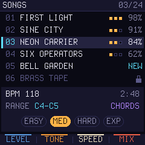
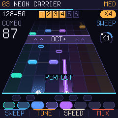
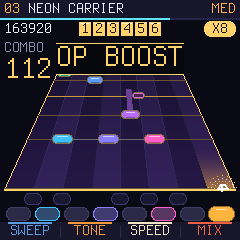
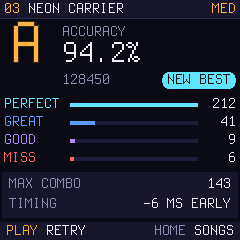

# KEYFALL for M-VAVE FM-1

*Arbeidstittel.* Et rytmespill i Guitar Hero-sjangeren for FM-1. Tonene glir ned en notebane, du spiller dem på de
27 tangentene, og LED-ene i tangentene viser hva som kommer. Tenkt som en Dinghy 0.4-app, i samme familie som
[RoboSeq](https://github.com/joakimskurk/fm1roboseq), [Star Distroyer](https://github.com/joakimskurk/fm1stardistroyer)
og [SkurkyMello](https://github.com/joakimskurk/fm1mello).

> **Status: idéstadiet.** Det som finnes er en konseptbeskrivelse og en mockup. Ingen kode ennå.

  
  
  
  

- **[docs/konsept.md](docs/konsept.md):** idéskissen, med spillmekanikk, nivåer, moduser, tekniske notater og
  neste steg.
- **[mockup/](mockup/):** `keyfall-mockup.html` tegner mockupen. Skjermene er tegnet piksel for piksel i
  240 × 240 med Dinghys egne Terminus-bitmaps (`terminus.js`). `node mockup/render.cjs` lager PNG-ene på nytt
  (krever Playwright).

Panelgeometrien i mockupen er hentet fra målene i
[Quixotic7/MvaveFM1-Designer](https://github.com/Quixotic7/MvaveFM1-Designer). Terminus-fonten er lisensiert under
SIL OFL 1.1 ([assets/fonts/Terminus-LICENSE.txt](assets/fonts/Terminus-LICENSE.txt)). Dette er et fanprosjekt og
ikke et offisielt M-VAVE-produkt.
