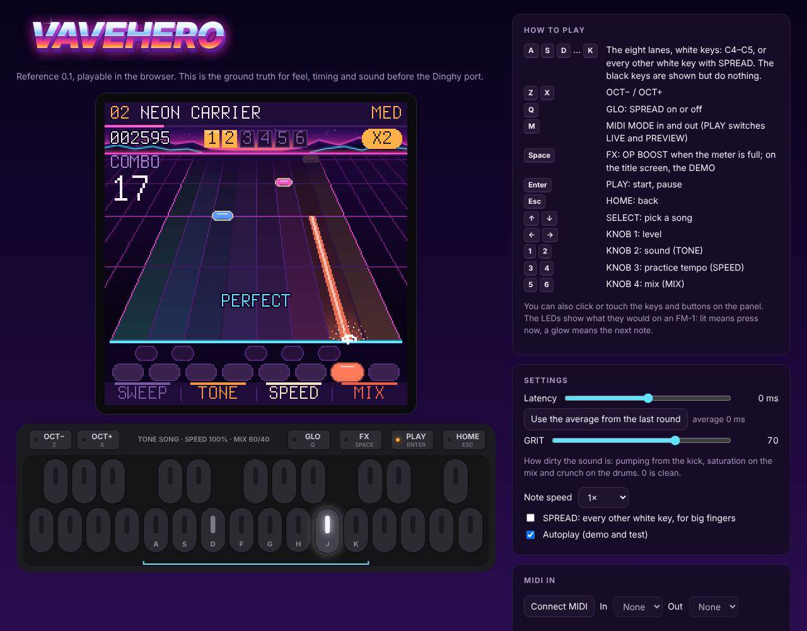
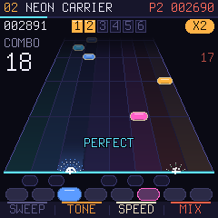
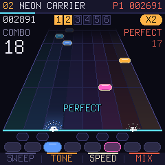
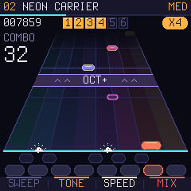
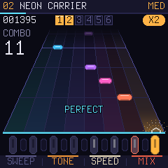
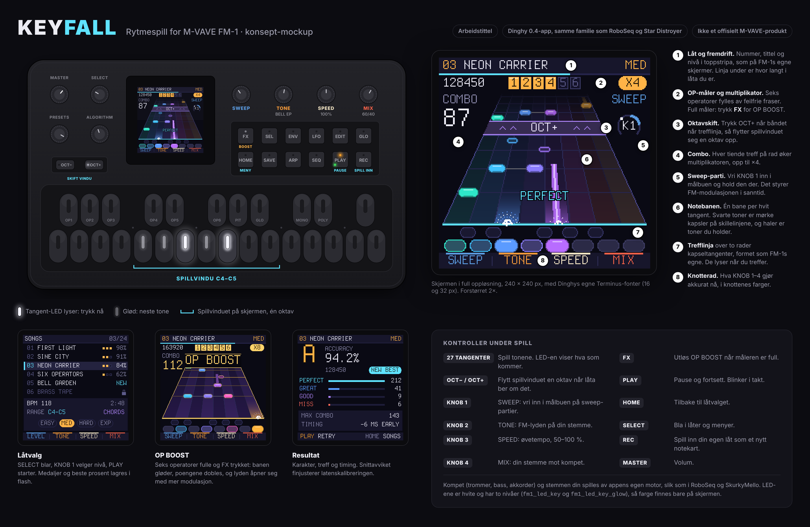

# KEYFALL for M-VAVE FM-1

*Arbeidstittel.* Et rytmespill i Guitar Hero-sjangeren for FM-1. Tonene glir ned en notebane, du spiller dem på de
hvite tangentene, og LED-ene i tangentene viser hva som kommer. To spillere med hvert sitt FM-1 kan spille mot
hverandre. Tenkt som en Dinghy 0.4-app, i samme familie som [RoboSeq](https://github.com/joakimskurk/fm1roboseq),
[Star Distroyer](https://github.com/joakimskurk/fm1stardistroyer) og [SkurkyMello](https://github.com/joakimskurk/fm1mello).

> **Status: nettleserreferanse 0.1, spillbar.** Det finnes ingen firmware ennå. Planen står i [ROADMAP.md](ROADMAP.md).

## Prøv det

Åpne [`reference/keyfall.html`](reference/keyfall.html) i en nettleser og trykk Enter. De hvite tangentene C4–C5 ligger
på `A S D F G H J K`, OCT− og OCT+ på `Z` og `X`, og FX (OP BOOST) på mellomromstasten. `Q` (GLO) slår på
SPREAD, som legger banene på annenhver hvit tangent for store fingre. Du kan også bruke et
MIDI-keyboard (Chrome og Edge), eller klikke og ta på panelet. Mer i [reference/README.md](reference/README.md).

## Lag dine egne låter

En låt er en vanlig MIDI-fil fra en DAW. Hvert instrument har sin kanal (2 BASS, 3 PAD, 4 ARP, 5 LEAD, 6 KEYS,
10 trommer), og spillsporet ligger på kanal 1. Lydmotoren spiller det hele i synthwave-drakt. Last fila inn i
referansen, så får du en rapport og kan spille den med en gang. Koble DAW-en til med WebMIDI, så hører du låta
gjennom lydmotoren mens du lager den. Alt står i [docs/songs.md](docs/songs.md), og malene ligger i [songs/](songs/).

## To spillere, to FM-1-er

Protokollen for to spillere er bakt inn fra start ([docs/link.md](docs/link.md)). Den består av MIDI-meldinger på
kanal 16 og klokke, de eneste meldingene en Dinghy-app mottar. I referansen virker den mellom to vinduer og mot en
bot. Målet er én USB-C-kabel mellom to FM-1-er, men det krever at det ene FM-1 kan være USB-vert. Det avklares i en
egen forstudie i fase 4. Via en datamaskin virker det uansett.

  
  
  
  

## Innhold

| | |
|---|---|
| [docs/konsept.md](docs/konsept.md) | Idéskissen: spillmekanikk, nivåer, moduser og tekniske notater |
| [docs/songs.md](docs/songs.md) | Lag dine egne låter: kanalene, reglene og eksporten |
| [docs/link.md](docs/link.md) | LINK: lagene fra nettleser til USB-C, og protokollen |
| [docs/DECISIONS.md](docs/DECISIONS.md) | Beslutningene D1–D4 |
| [songs/](songs/) | De innebygde låtene som MIDI-filer, også maler (`python3 tools/songs.py` lager dem) |
| [ROADMAP.md](ROADMAP.md) | Fasene, med avkrysning |
| [reference/](reference/) | Nettleserreferansen, fasit før porten |
| [mockup/](mockup/) | Den første mockupen: enheten og fire skjermer (`node mockup/render.cjs` lager PNG-ene) |
| [tests/reference.cjs](tests/reference.cjs) | Spiller referansen i Chromium og sjekker poeng, LINK og bot |

Panelgeometrien er hentet fra målene i [Quixotic7/MvaveFM1-Designer](https://github.com/Quixotic7/MvaveFM1-Designer).
Låtene er egne komposisjoner. Terminus-fonten er lisensiert under SIL OFL 1.1
([assets/fonts/Terminus-LICENSE.txt](assets/fonts/Terminus-LICENSE.txt)). Dette er et fanprosjekt og ikke et
offisielt M-VAVE-produkt.
