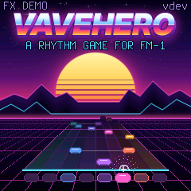

# KEYFALL for M-VAVE FM-1

*Arbeidstittel.* Et rytmespill i Guitar Hero-sjangeren for FM-1. Tonene glir ned en notebane, du spiller dem på de
hvite tangentene, og LED-ene i tangentene viser hva som kommer. To spillere med hvert sitt FM-1 kan spille mot
hverandre. En Dinghy 0.5-app, i samme familie som [RoboSeq](https://github.com/joakimskurk/fm1roboseq),
[Star Distroyer](https://github.com/joakimskurk/fm1stardistroyer) og [SkurkyMello](https://github.com/joakimskurk/fm1mello).

> **Status: nettleserreferanse 0.1 og firmware 0.1 under arbeid, begge spillbare.** Firmwaren har spillet, alle fire
> låtene, lydmotoren og MIDI MODE LIVE. Den er testet på verten og målt i fm1-emu, men ikke prøvd på et ekte FM-1 ennå.
> Planen står i [ROADMAP.md](ROADMAP.md).

<p align="center"></p>

## Prøv det

Åpne [`reference/keyfall.html`](reference/keyfall.html) i en nettleser og trykk Enter. De hvite tangentene C4–C5 ligger
på `A S D F G H J K`, OCT− og OCT+ på `Z` og `X`, og FX (OP BOOST) på mellomromstasten. `Q` (GLO) slår på
SPREAD, som legger banene på annenhver hvit tangent for store fingre. Du kan også bruke et
MIDI-keyboard (Chrome og Edge), eller klikke og ta på panelet. Mer i [reference/README.md](reference/README.md).

## Lag dine egne låter

En låt er en vanlig MIDI-fil fra en DAW. Hvert instrument har sin kanal (2 BASS, 3 PAD, 4 ARP, 5 LEAD, 6 KEYS,
10 trommer), og spillsporet ligger på kanal 1. Lydmotoren spiller det hele i synthwave-drakt, og hvert
instrument har flere patcher du velger med nøkkelnoter (note 0–11) på kanalen. GRIT-innstillingen og de skitne
patchene (DIRT BASS, FUZZ LEAD, DIRT-trommer og flere) gir den franske, skitne lyden. Last fila inn i
referansen, så får du en rapport og kan spille den med en gang. Koble DAW-en til med WebMIDI, så hører du låta
gjennom lydmotoren mens du lager den. Alt står i [docs/songs.md](docs/songs.md), og malene ligger i [songs/](songs/).

**MIDI MODE** (nederst i låtlista) kobler DAW-en rett til FM-1 med USB-C. LIVE gjør FM-1 til en lydmodul med en
skjerm for kanalene, og tangentene sendes ut til DAW-en for opptak. PREVIEW forsinker alt én takt, slik at
spillsporet faller ned banen som i spillet og du kan prøve å spille det mens du skriver det.

## To spillere, to FM-1-er

Protokollen for to spillere er bakt inn fra start ([docs/link.md](docs/link.md)). Den består av MIDI-meldinger på
kanal 16 og klokke, de eneste meldingene en Dinghy-app mottar. I referansen virker den mellom to vinduer og mot en
bot. Målet er én USB-C-kabel mellom to FM-1-er, men det krever at det ene FM-1 kan være USB-vert. Det avklares i en
egen forstudie i fase 4. Via en datamaskin virker det uansett.

<p align="center">
  
  
  
  
</p>

## Firmware

Firmwaren er en Dinghy 0.5-app (`firmware/src/keyfall.c`, [PLATFORM.md](PLATFORM.md) sier hva som er endret fra
Dinghy). Den spiller som referansen: samme regler, samme notekart, samme skjermer og samme lyd.

<p align="center">
  
  
  
  
  
</p>

| | |
|---|---|
| Tittelskjermen | PLAY går til låtene. FX starter DEMO-en, ENGINE TOUR på autospill. |
| Låtene | SELECT velger låt. KNOB 1 velger nivå, KNOB 2 stemme (TONE), KNOB 3 fart og KNOB 4 MIX. ALGORITHM styrer GRIT. GLO slår SPREAD av og på, og SEQ slår AUTO av og på (låta spiller seg selv, og resultatet lagres ikke). PLAY starter. |
| Under en låt | De åtte tangentene i oppsettet spiller banene. OCT− og OCT+ følger oktavskiftene, FX gir OP BOOST, PLAY er pause og HOME avslutter. |
| Resultatet | Beste resultat per låt og nivå lagres i flash. PLAY spiller igjen, HOME går til låtene. |
| MIDI MODE | LIVE: FM-1 er lydmodul for låta, én del per kanal, med nøkkelnoter. Tangentene sendes ut på kanal 1. PREVIEW kommer senere. |

Tangent-LED-ene viser hva som kommer: lyser når tonen er ved linja, gløder når den kommer innen to slag.

**Målt i fm1-emu:** det tyngste stedet i låtene, takt 41–44 i ENGINE TOUR, bruker 31,6 % av brikken til lyd, og
34,4 % med plattformens avbrudd. Spillskjermen er beregnet til omtrent 9 % ved 30 bilder i sekundet. Alle 25
patcher og 4 trommesett ligger innenfor 1,5 dB av referansen, og hele låtene innenfor 0,8 dB. Mer i
[docs/fm1-budsjett.md](docs/fm1-budsjett.md).

```sh
make test          # KEYFALLs vertstester: lyden mot referansen, reglene, skjermene; uten FM-1
make fw            # build/keyfall.fwsc: krever JieLis verktøykjede og AC79-SDK-en (docs/DINGHY_README.md)
```

GitHub Actions bygger `.fwsc`-pakken ved hver push, kjører testene og måler DEMO-en i fm1-emu
(`.github/workflows/build.yml`, via zvenson/fm1-build). Pakken heter `FM-1_95N`, der N er mindreversjonen, og 0 er
en utviklerbygging.

**Prøv den uten FM-1:** last ned `packages` fra en bygging under *Actions* på GitHub, pakk ut `keyfall.fwsc` og åpne
den i [fm1-emu](https://joakimeriksson.github.io/fm1-emu/) i nettleseren. Siden kan åpne en lokal pakke. Tangentene
og knappene ligger på datamaskinens tastatur og mus, og et MIDI-keyboard virker i Chrome og Edge.

## Innhold

| | |
|---|---|
| [docs/konsept.md](docs/konsept.md) | Idéskissen: spillmekanikk, nivåer, moduser og tekniske notater |
| [docs/songs.md](docs/songs.md) | Lag dine egne låter: kanalene, reglene og eksporten |
| [docs/link.md](docs/link.md) | LINK: lagene fra nettleser til USB-C, og protokollen |
| [docs/fm1-budsjett.md](docs/fm1-budsjett.md) | Får alt plass på FM-1? Minne, CPU, grafikk, låter og poeng |
| [docs/DECISIONS.md](docs/DECISIONS.md) | Beslutningene D1–D8 |
| [songs/](songs/) | De fire innebygde låtene som MIDI-filer, også maler. ENGINE TOUR viser alle 29 lydene, CHROME HORIZON er en hel låt i D-moll (`python3 tools/songs.py` lager dem). |
| [ROADMAP.md](ROADMAP.md) | Fasene, med avkrysning |
| [reference/](reference/) | Nettleserreferansen, fasit før porten |
| [mockup/](mockup/) | Den første mockupen: enheten og fire skjermer (`node mockup/render.cjs` lager PNG-ene) |
| [tests/reference.cjs](tests/reference.cjs) | Spiller referansen i Chromium og sjekker poeng, LINK og bot |
| [firmware/](firmware/) | Firmwaren: Dinghy 0.5 og appen `src/keyfall.c` |
| [PLATFORM.md](PLATFORM.md) | Hvilken Dinghy, og hva som er endret fra den |
| [docs/API.md](docs/API.md), [docs/RULES.md](docs/RULES.md) | Dinghys API og brikkens regler (fra Dinghy) |

<p align="center"></p>

Panelgeometrien er hentet fra målene i [Quixotic7/MvaveFM1-Designer](https://github.com/Quixotic7/MvaveFM1-Designer).
Låtene er egne komposisjoner. Firmwaren er fri programvare under GPL-3.0 ([LICENSE](LICENSE), hvem som har laget
hva står i [LICENSING.md](LICENSING.md)). Terminus-fonten er lisensiert under SIL OFL 1.1
([assets/fonts/Terminus-LICENSE.txt](assets/fonts/Terminus-LICENSE.txt)). Dette er et fanprosjekt og ikke et
offisielt M-VAVE-produkt.
