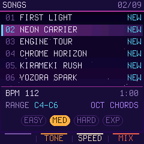
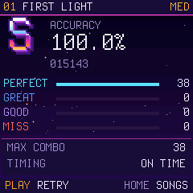
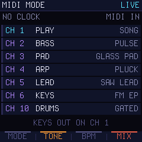

<p align="center"></p>

# VaveHero for M-VAVE FM-1

I've always loved rhythm games. Countless hours with apps, in Japanese arcades and with Clone Hero, so this had
to happen.

VaveHero takes this to the FM-1. Notes come down a neon highway, you play them on the white keys while the key LEDs
show what is coming, and a synthwave band plays along.

> **An early version** with four songs, and more are coming. It is tested in CI and in an FM-1 emulator, but **not
> yet tried on a real FM-1**: install it at your own risk. **Testers wanted:** have an FM-1? Tell us how it went in
> an [issue](https://github.com/joakimskurk/fm1vavehero/issues).

<p align="center"></p>

## Install

Open **[the VaveHero page](https://joakimskurk.github.io/fm1vavehero/)** in Chrome or Edge, connect the FM-1 with a
USB cable, and press Install.

If the FM-1 will not start, hold **OCT−** while switching it on and install again. To go back to the official
firmware, use M-VAVE's updater M-UPGRADE.

## Play it in the browser

No FM-1? [Play it in the browser](https://joakimskurk.github.io/fm1vavehero/play.html). The lanes are on
`A S D F G H J K`, OCT− and OCT+ on `Z` and `X`, and FX on the space bar. A MIDI keyboard works too, in Chrome and
Edge.

## Playing it

| | |
|---|---|
| PLAY | Start a song, or pause it. On the title screen, FX plays a demo. |
| SELECT | Pick a song. Each song has its own level, from EASY to EXP. |
| In a song | Play the notes on the white keys C4–C5. OCT− and OCT+ when the song changes octave, FX for OP BOOST, HOME to quit. |
| KNOB 2–4 | Your sound, the speed for practice, and the mix. |
| ALGORITHM | GRIT: how dirty the sound is. |
| GLO | SPREAD: every other white key, for big fingers. |
| SEQ | AUTO: the song plays itself. |
| MIDI MODE | The last song in the list: the FM-1 as a sound module for your DAW. |

<p align="center">
  
  
  
  
</p>

## Your own songs

A song is an ordinary MIDI file: channel 1 is the part you play, and the other channels are the band. Load it into
the browser version to get a report and play it right away. How to make one: [docs/songs.md](docs/songs.md). The
built-in songs in [songs/](songs/) work as templates.

Then send it in, in an [issue](https://github.com/joakimskurk/fm1vavehero/issues) or a pull request to `songs/`.
Only songs of your own, not covers, and say that it may be shared under the GPL-3.0.

## For developers

```sh
make test          # the host tests, no FM-1 needed
make fw            # build/vavehero.fwsc: needs JieLi's toolchain and the AC79 SDK (docs/DINGHY_README.md)
```

CI builds the package on every push, runs the tests and times the game in fm1-emu.

| | |
|---|---|
| [reference/](reference/) | The browser version: the ground truth the firmware follows |
| [firmware/](firmware/), [PLATFORM.md](PLATFORM.md) | The firmware (Dinghy 0.5 and the app `src/vavehero.c`), and what was changed in Dinghy |
| [docs/DECISIONS.md](docs/DECISIONS.md) | The design decisions |
| [docs/fm1-budget.md](docs/fm1-budget.md) | What fits on the FM-1: memory, CPU and the measurements |
| [docs/link.md](docs/link.md) | Two players (LINK), in the browser version for now |
| [ROADMAP.md](ROADMAP.md) | The plan |

## Credits

- [Dinghy](https://github.com/zvenson/dinghy) by **zvenson**: the platform VaveHero is built on, and
  [fm1-build](https://github.com/zvenson/fm1-build) for CI.
- [Felucca](https://github.com/hugelton/Felucca) by **Leo Kuroshita** (Hügelton Instruments) and
  [SLOOP](https://github.com/isod89/sloop-fm1) by **isod89**: the platform under Dinghy, and the browser installer.
- [fm1-emu](https://github.com/joakimeriksson/fm1-emu) by **joakimeriksson**: the FM-1 emulator it is tested in.
- [MvaveFM1-Designer](https://github.com/Quixotic7/MvaveFM1-Designer) by **Quixotic7**: the panel's measurements.
- The fonts Terminus and Inter (Rasmus Andersson), both SIL OFL 1.1.

Free software under the GPL-3.0 ([LICENSE](LICENSE); who made what: [LICENSING.md](LICENSING.md)). The songs are
original. A fan project, not an official M-VAVE product. More FM-1 firmware in the same family:
[RoboSeq](https://github.com/joakimskurk/fm1roboseq), [Star Distroyer](https://github.com/joakimskurk/fm1stardistroyer)
and [SkurkyMello](https://github.com/joakimskurk/fm1mello).
