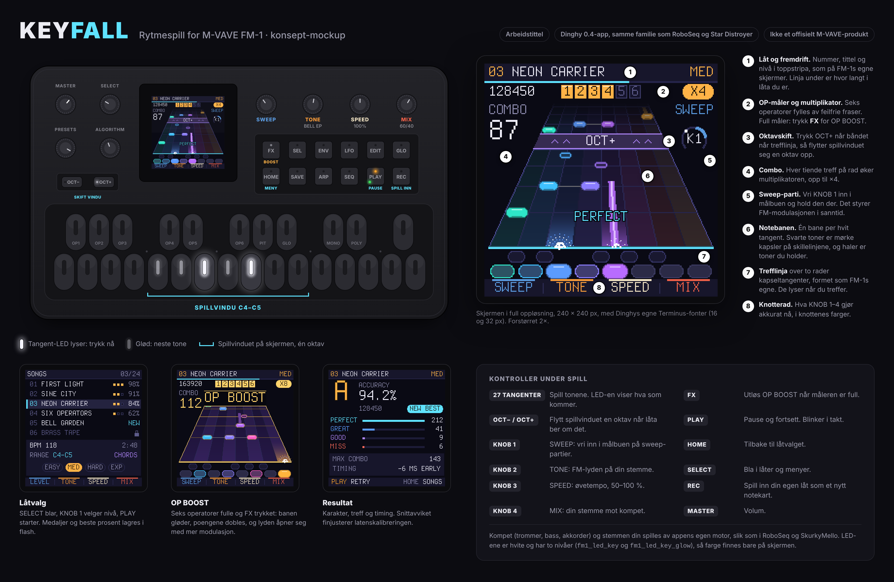

# KEYFALL: et rytmespill for M-VAVE FM-1 (idéskisse)

*Arbeidstittel. Inspirert av sjangeren Guitar Hero satte, men med egen grafikk, egne låter og spillmekanikk bygget
rundt FM-1s eget panel. «Hero» er Activisions varemerke, så et eget navn er tryggest hvis dette skal deles.*

## Kjerneidé

Toner glir nedover en notebane mot en trefflinje, og du spiller dem på FM-1s 27 tangenter i takt med musikken.
FM-1 er kontroller, lydkilde og spillkonsoll på én gang. Den har to ting en gitarkontroller ikke har:

- **En LED i hver tangent.** Spillet kan lyse opp tangenten du skal trykke nå, og la de neste gløde svakt.
  Skjermen viser hva som kommer, og tangentene viser hvor du skal trykke.
- **En synth.** Lyden kan svare på hvordan du spiller. Spiller du feilfritt, åpner patchen seg. Bommer du, blir
  tonen matt og ustemt.

## Hva FM-1 og Dinghy gir oss

| | |
|---|---|
| Tangenter | 27 silikontangenter, F3–G5 (16 hvite, 11 svarte), i to rader med kapselformede tangenter. Skannes ved 10 kHz og debounces. `fm1_input_note_edges()` fanger også trykk som er kortere enn én runde i hovedløkka. |
| LED | En hvit LED per tangent og per knapp, i to nivåer: `fm1_led_key` (lyser) og `fm1_led_key_glow` (glød, ~1/24). REC er rød, PLAY er oransje og har en grønn LED i tillegg. |
| Skjerm | 240 × 240 px, 16-bit farge. To fonter: `FONT_S` (Terminus 16 px) og `FONT_L` (32 px, bare store bokstaver). Tegnes i lerreter som sendes med DMA (en stripe på 240 × 64 tar ca. 3 ms). |
| Knotter | KNOB 1–4 under skjermen, SELECT, PRESETS, ALGORITHM og MASTER (volum). |
| Knapper | FX, SEL, ENV, LFO, EDIT, GLO, HOME, SAVE, ARP, SEQ, PLAY, REC, og OCT− / OCT+. |
| Lyd | Appens egen motor i lydavbruddet: 44,1 kHz, 256 frames hvert 5,8 ms, bare fastkomma. |
| MIDI | USB-MIDI inn og ut, TRS MIDI inn, og MIDI-klokke inn. |
| Lagring | Innstillinger, 8 blobs og 8 slots i flash. |

I M-VAVEs egen firmware er de seks første svarte tangentene **OP1–OP6**. Det passer godt til spillets
«seks operatorer»-måler.

## Slik lages det (samme oppskrift som de andre FM-1-prosjektene)

1. **`reference/keyfall.html`, en spillbar nettleserversjon.** Den er fasit for lyd, følelse og timing, slik
   `roboseq.html` og `skurkymello.html` er det for sine prosjekter. Den spilles med tastaturet på datamaskinen, og
   valgfritt med et FM-1 eller annet MIDI-keyboard over WebMIDI. Her finner vi ut om spillet er gøy: banebredde,
   tidsvinduer, nivåer og notekart.
2. **En Dinghy 0.4-app**, laget som RoboSeq og Star Distroyer: `keyfall.c`, `APP_NAME "KEYFALL"`, egen
   `FELUCCA_ID`, testet på verten og i fm1-emu, og levert som `.fwsc` med commit og SHA-256. Den kan også få et
   `fmhub.json`-kort til Firmware Hub.
3. **Gjenbruk fra egne repoer:**
   - **RoboSeq:** BAND-motoren (trommer, bass, komp), battle-modus med delt tangentbord, minikeyboardet nederst
     på skjermen, spillbarhetsreglene P1–P4, og lydtesten mot renders av HTML-referansen.
   - **SkurkyMello:** akkordstemmer, trommeruter og bass.
   - **Star Distroyer:** FM-stemmen.
   - **FM1Tracker:** datamodellen for mønstre kan bli grunnlaget for notekart.

## Spillet

### Notebanen

- **Bare de hvite tangentene spilles** ([beslutning D1](DECISIONS.md)). Ett spillvindu er én oktav: åtte baner,
  én per hvit tangent fra C til C. De svarte tangentene vises på skjermen der de sitter, men har ingen funksjon. De
  gir ingen poeng og ingen straff.
- **SPREAD for store fingre** ([D2](DECISIONS.md)): banene legges på annenhver hvit tangent (F3 A3 C4 E4 G4 B4 D5 F5),
  med én ubrukt tangent mellom hver. Musikken er den samme, bare med mer plass mellom fingrene. SPREAD slås av og på
  med GLO.
- **Hvite tangenter betyr ikke bare C-dur.** Spillet kan transponere lyden, så de hvite tangentene følger låtas
  toneart. En låt i Es-dur spilles med C-dur-grep og høres i Es. Modusene får man ved å velge grunntone: A-moll,
  D-dorisk, E-frygisk og så videre.
- Nederst på skjermen står tangentstripa i to rader, formet som FM-1s kapseltangenter: de svarte øverst, de hvite
  under. Med SPREAD viser den de brukte tangentene med LED-stripe, og en mørk, ubrukt tangent mellom hver.
- **Oktavskift:** et lilla OCT+- eller OCT−-bånd kommer ned banen. Trykk knappen i takt, så flytter vinduet seg en
  oktav. Slik får en låt større toneomfang uten at banene blir for smale.
- **Haler** er toner du holder. **Akkorder** er toner på samme linje, bundet sammen med en tynn strek.

### Nivåer: flere tangenter, ikke bare flere toner

| Nivå | Tangenter | Innhold |
|---|---|---|
| EASY | 5 hvite (C–G, én håndstilling) | Enkeltoner, ingen skift |
| MED | Hele oktaven C–C, 8 hvite | Toakkorder, haler, et og annet OCT-skift |
| HARD | Hele oktaven, 8 hvite | Raske løp, treklanger, hyppige skift, sweep-partier |
| EXP | Alle 16 hvite tangenter, F3–G5, på en flat bane (14,5 px per bane) | Alt |

Nivåene kan genereres fra én MIDI-fil: tonene flyttes inn i vinduet, akkorder tynnes ut, og rytmen kvantiseres.

### Poeng

- PERFECT ±35 ms, GREAT ±70 ms, GOOD ±110 ms. Alt utenfor er MISS. Vinduene justeres i HTML-referansen.
- Hver tiende treff på rad øker multiplikatoren, opp til ×4.
- **OP BOOST** er spillets «star power». Seks segmenter, ett per operator. Toner i en OP-frase har en lys kant,
  og en feilfri frase tenner to operatorer. Når måleren er full, blinker FX-LED-en. Trykk **FX**, så får du dobbel
  poengsum i 4 takter. Banen gløder gult og patchen åpner seg med høyere modulasjonsindeks.
- **Sweep-partier** er en egen mekanikk (gitarspillets whammy-bar finnes ikke her). En målbue vises, og du vrir
  **KNOB 1** inn i den og holder den der. Knotten styrer FM-modulasjonen i sanntid, så du hører at du treffer.

### Lyden: synthwave

Lydmotoren er laget for synthwave og retrowave ([D4](DECISIONS.md)): detunede sagtann-pads med chorus og stor hall,
pulserende åttedelsbass, arpeggio med tempo-delay, en sagtann-lead, FM-piano, skarptromme og klapp med gated reverb,
og syndrum-tammer. Spilleren velger sin egen stemme med KNOB 2 (TONE): SYN LEAD, BELL EP, BRASS eller GLASS.

### Lyden svarer

- En lang combo gjør lyden gradvis lysere (filteret eller modulatoren åpner seg).
- En bom demper tonen kort og gjør den litt ustemt, uten at kompet stopper.
- Dette er hovedforskjellen fra en gitarkontroller: på FM-1 er instrumentet og spillet det samme.

## Moduser

- **Settliste:** låter som låses opp etter hvert, med medaljer og beste prosent lagret i flash.
- **Øving:** SPEED (KNOB 3) fra 50 til 100 %, loop av et parti, og «vent på riktig tangent» (spillet venter til du
  treffer). Du kan også øve én hånd om gangen.
- **Lytt og gjenta:** spillet spiller en frase mens LED-ene viser den, og så spiller du den tilbake. Det passer
  godt til den lille skjermen og egner seg som opplæring.
- **To spillere, to FM-1-er (LINK):** hver spiller har sitt FM-1, og enhetene kobles sammen. I VS spiller begge
  samme låt samtidig og ser hverandres poeng. Senere kommer annenhver frase og band (samarbeid). Protokollen er
  bakt inn fra start, og målet er én USB-C-kabel mellom enhetene. Se [link.md](link.md), og om hvorfor USB-C direkte
  krever USB-vertsmodus.
- **Duell på ett FM-1:** en enklere variant der hver spiller får sin ende av klaviaturet, slik som i RoboSeqs
  battle.
- **Spill inn (REC):** spill inn en melodi på FM-1, så lagres den som et notekart en venn kan spille. Det oppfyller
  RoboSeqs regel om at det alltid skal være noe å spille.
- **Kalibrering:** trykk i takt med et klikk, så lagres et latensavvik. Resultatskjermen viser snittet, som
  finjusterer kalibreringen over tid.

## Skjermene

Se `mockup/screens/` (240 × 240 px, nøyaktig som de ville tegnes): **SONGS**, **spill**, **OP BOOST** og
**resultat**. Felles regler:

- Toppstripe med nummer, tittel og nivå, og bunnstripe som viser hva KNOB 1–4 gjør, i knottenes farger.
- Bare `FONT_S` og `FONT_L`. Store tall (combo, prosent, karakter) bruker `FONT_L`.
- Pikselgrafikk uten kantutjevning. Glød lages med én piksel mørkere kant, ikke uskarphet.

## Tekniske notater

- **Presis timing:** les tangentkantene i `LCD_IDLE`-kroken mens DMA sender skjermen, og stemple dem med
  `fm1_ticks()`. Ellers kan et trykk bli liggende en hel tegnerunde (10–15 ms) før det registreres.
- **Tegning:** banen tegnes på nytt hver frame, i striper. Perspektivet er bare rader med ulik bredde, så det koster
  omtrent det samme som en flat bane. Målet er minst 30 fps for banen. Toppstripa og knotteraden tegnes bare når de
  endrer seg.
- **Lyd:** spillerens stemme og kompet går i samme lydavbrudd, med fastkomma og begrenset arbeid per blokk, som i
  de andre prosjektene. Spillogikken holdes i hovedløkka og kommuniserer med lyden gjennom `volatile`-variabler.
- **Låter er MIDI-filer** ([D3](DECISIONS.md), [songs.md](songs.md)). Hvert instrument har sin MIDI-kanal, og
  spillsporet ligger på kanal 1. De lages i en DAW, prøves i referansen, og gjøres om til et kompakt notekart for
  firmwaren, for eksempel 4 byte per tone (tid, tangent, lengde, flagg). 1000 toner tar 4 KB, så 20–30 låter kan
  ligge i flash. Egne innspillinger går i slots.
- **Lydmotoren på FM-1:** synthwave-lyden må lages i fastkomma. Det betyr sagtann med PolyBLEP, enkle filtre,
  chorus, gated reverb og hall, og det må måles i fm1-emu. Star Distroyer har allerede oscillatorer, delay og
  romklang i fastkomma på FM-1.
- **Låter:** bruk egne komposisjoner, egne arrangementer av musikk som er fri for opphavsrett, eller låter fra
  miljøet. Ikke kommersielle låter.

## Åpne spørsmål

- Hvor stor er den faktiske latensen fra tangent via lyd til øre på ekte maskinvare? Det kan vi først måle når det
  finnes et FM-1 å teste på. Fram til da brukes fm1-emu og vertsbygget.
- Går det an å få anslagsdynamikk fra silikontangentene? Hvis ja, kan aksenttoner bli en egen notetype.
- Perspektivbane eller flat bane på EXP? Det avgjøres i HTML-referansen.
- Navn: KEYFALL, OP RUSH, SIX OPS, CARRIER eller SKURKY KEYS?

## Plan

Planen med faser og avkrysning står i [ROADMAP.md](../ROADMAP.md):

0. Idé og mockup (ferdig)
1. Nettleserreferanse 0.1 (ferdig): spillbar, med LINK i to vinduer og mot bot
2. Referanse 0.2: spillfølelse, sweep, øving, flere låter, notekartformat
3. Dinghy-port
4. **LINK på maskinvare: to FM-1-er koblet med USB-C.** Forstudien om USB-vertsmodus kan starte nå.
5. Utgivelse
