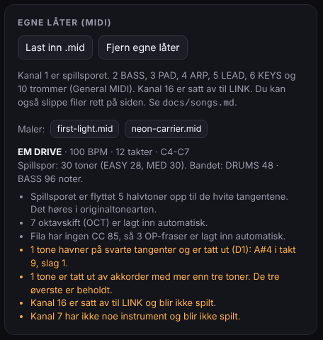
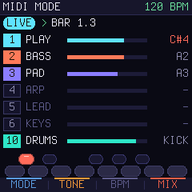
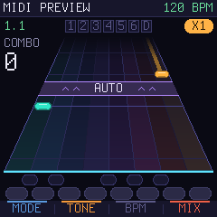

# Lag dine egne låter

En Keyfall-låt er en vanlig MIDI-fil (`.mid`), laget i hvilken som helst DAW. Hvert instrument har sin egen
MIDI-kanal, og spillsporet, tonene spilleren skal spille, ligger på en kanal for seg. Lydmotoren spiller resten i
synthwave-drakt ([D3](DECISIONS.md), [D4](DECISIONS.md)).

De to innebygde låtene er laget nøyaktig slik, og fungerer som maler: [`songs/first-light.mid`](../songs/first-light.mid)
og [`songs/neon-carrier.mid`](../songs/neon-carrier.mid). Du kan også laste dem ned fra referansen.

## Kanalene

| Kanal | Del | Lyd i referansen |
|---|---|---|
| **1** | **PLAY**, spillsporet | Tonene som faller ned banen. Spilleren lager lyden selv (TONE: SYN LEAD, BELL EP, BRASS, GLASS). |
| 2 | BASS | To detunede sagtann-oscillatorer og en sub, resonant lavpass. Laget for pulserende åttedeler. |
| 3 | PAD | Fire detunede sagtann-oscillatorer, langsomt filtersveip, chorus og stor hall |
| 4 | ARP | Firkant og sagtann, kort og lys, med tempo-delay |
| 5 | LEAD | Sagtann-lead med vibrato og delay (motstemme, intro) |
| 6 | KEYS | FM-piano |
| 10 | DRUMS | General MIDI-trommer (under), tre trommesett |
| 16 | *LINK* | Satt av til tospillerprotokollen. Noter her blir ikke spilt. |

Kanal 7–9 og 11–15 har ingen lyd ennå. Importen sier fra hvis de brukes.

### Patcher: flere lyder per instrument ([D6](DECISIONS.md))

Hvert instrument har flere patcher. Du velger patch med en **nøkkelnote** (keyswitch) på instrumentets egen kanal:
note 0–11, under ethvert musikalsk register, som aldri høres. Note 0 gir patch 1, note 1 patch 2, og så videre.
Patchen gjelder fra nøkkelnoten og til neste. Uten nøkkelnote brukes patch 1. En nøkkelnote kan ligge samtidig med
første tone den skal gjelde for.

| Kanal | Note 0 (C-1) | Note 1 (C#-1) | Note 2 (D-1) | Note 3 (D#-1) |
|---|---|---|---|---|
| 1 PLAY | SYN LEAD | BELL EP | BRASS | GLASS |
| 2 BASS | PULSE (pulserende sagtann) | FM BASS | SUB |  |
| 3 PAD | SUPERSAW | STRINGS | GLASS PAD (FM) |  |
| 4 ARP | PLUCK | BELL (FM) | SQUARE |  |
| 5 LEAD | SAW LEAD | SQUARE LEAD | BRASS LEAD |  |
| 6 KEYS | FM EP | TINE | ORGAN |  |
| 10 DRUMS | GATED (80-talls gated reverb) | TIGHT (tørt) | BOOM (lang kick, lange tammer) |  |

- Mange DAW-er kaller note 0 for **C-1**. Noen, blant annet Cubase, kaller den **C-2**. Det er samme note.
- På kanal 1 velger nøkkelnoten spillerens stemme gjennom låta, når TONE (KNOB 2) står på **SONG**, som er standard.
  Spilleren kan alltid velge en fast stemme med KNOB 2 i stedet.
- På kanal 1 er note 11 (B-1) satt av til OP-fraser (se under), så stemmene ligger på note 0–3.
- En nøkkelnote uten patch, for eksempel note 7 på BASS, gjør ingenting og vises i importrapporten.
- Alt er noter. Program Change og CC brukes ikke, så alt kan tegnes rett i pianorullen.
- Det virker likt live: send nøkkelnoter fra DAW-en, så bytter lyden med en gang (i PREVIEW i takt med resten), og
  LIVE-skjermen viser patchen på hver kanal.

NEON CARRIER viser hvordan: bassen går til FM BASS i refrenget, padden til STRINGS og spillerens stemme til BELL EP i
det høye verset.

### Trommer på kanal 10

| Note | Lyd |
|---|---|
| 35, 36 | Kick |
| 38, 40 | Skarptromme med gated reverb |
| 39 | Klapp (gated) |
| 37 | Kantslag |
| 42, 44 | Lukket hi-hat |
| 46 | Åpen hi-hat |
| 49, 57 | Crash |
| 41, 43, 45, 47, 48, 50 | Syndrum-tammer, fra lav til høy |

## Spillsporet (kanal 1)

- **Bare hvite tangenter** ([D1](DECISIONS.md)). Du kan skrive i hvilken som helst toneart. Importen finner den
  transponeringen som legger flest toner på de hvite tangentene, og låta høres likevel i originaltonearten. En låt i
  E-moll spilles da med A-moll-grep. Toner som fortsatt havner på svarte tangenter, tas ut og vises i rapporten.
- **Oktaver ordner seg selv.** Banen viser én oktav (C til C). Når melodien går ut av den, legger importen inn et
  oktavskift (OCT+ eller OCT−) mellom to toner. Gi gjerne melodien minst et halvt slag pause før store sprang.
- **Akkorder:** høyst tre toner samtidig, innenfor én oktav. Toner ut over det tas ut.
- **Holdtoner:** en tone på 1,5 slag eller mer blir en holdtone med hale. Kortere toner er vanlige trykk.
- **OP-fraser:** legg note 11 (B-1) på kanal 1 og hold den så lenge frasen varer. I pianorullen er det en strek
  under frasen. Feilfrie fraser fyller OP-måleren. Uten OP-noter lager importen fraser selv (to takter av hver
  fjerde).
- **EASY** lages av samme spor: tonene på slaget (eller hvert andre slag over 105 BPM), og bare den øverste tonen i
  en akkord.

## Tempo og takt

- Ett tempo per låt. Har fila tempoendringer, brukes det første.
- Keyfall teller i 4/4. Andre taktarter importeres, men banens taktstreker følger 4/4.
- Låta slutter ved slutten av takten der den siste tonen slutter.

## Eksporter

Eksporter som **Standard MIDI File**, format 0 eller 1. Begge virker, og tiden må være i takt og slag (PPQ, ikke
SMPTE). Navnet på det første sporet blir låtens tittel, ellers filnavnet. Tittelen vises med store bokstaver og
høyst 15 tegn.

## Prøv låta i referansen

1. Åpne `reference/keyfall.html`.
2. Trykk **Last inn .mid** under *Egne låter*, eller slipp fila på siden.
3. Rapporten viser tempo, lengde, toner per nivå, transponering, oktavskift, OP-fraser og alt som er tatt ut eller
   ignorert.
4. Låta havner nederst i låtlista og huskes i nettleseren. **Fjern egne låter** tømmer lista.

## MIDI MODE: DAW-en rett i FM-1 ([D5](DECISIONS.md))

 

1. Koble FM-1 til datamaskinen med USB-C. Den dukker opp som en MIDI-enhet.
2. På FM-1: bla til **MIDI MODE** nederst i låtlista og trykk PLAY.
3. I DAW-en: send hvert spor til FM-1 på sin kanal (1 spillsporet, 2 BASS, 3 PAD, 4 ARP, 5 LEAD, 6 KEYS,
   10 trommer). Slå på **MIDI-klokke ut** til FM-1, så følger den tempoet og viser takt og slag.
4. **LIVE** spiller alt med en gang, og viser aktivitet og siste tone per kanal. Toner på kanal 1 lyser opp
   tangentene, og en tone på en svart tangent blir rød.
5. Trykk PLAY for **PREVIEW**: alt forsinkes én takt, og spillsporet faller ned banen slik det blir i spillet. Spill
   med på tangentene for å kjenne om det er spillbart. Røde merker er toner på svarte tangenter, som blir tatt ut ved
   import.
6. **Ta opp fra FM-1:** tangentene sendes ut på kanal 1. Slå av MIDI-ekko (thru) til FM-1 på sporet du tar opp på,
   ellers spilles tonene to ganger.
7. Uten klokke: still tempoet med KNOB 3 (BPM). HOME går tilbake til låtlista.

Gode å vite:

- Start DAW-en fra takt 1. FM-1 får ikke låtposisjonen (Song Position Pointer), så takttelleren starter der DAW-en
  starter.
- Skru av DAW-ens egen lyd i PREVIEW, ellers hører du alt to ganger med én takts mellomrom.
- LINK må være av. MIDI MODE og tospiller-lenken bruker begge MIDI-klokka.

**I referansen** er det det samme: koble DAW-en til nettleseren med WebMIDI (Chrome eller Edge, *Koble til MIDI*),
velg den som «Inn», og eventuelt en port som «Ut» for opptak. På Mac går det med IAC-driveren, på Windows med for
eksempel loopMIDI. Utenfor MIDI MODE spiller referansen også kanalene direkte, men uten skjermen for kanaler og
uten PREVIEW.

## To spillere

I VS sender P1 låtens identitet, en hash av spillsporet (se [link.md](link.md)). P2 må ha samme fil lastet inn. Hvis
ikke viser P2s skjerm `SONG NOT HERE`.

## På FM-1

I firmwaren blir låtene gjort om til et kompakt notekart i flash av et lite verktøy. Kanalene og reglene over er de
samme, så en låt som virker i referansen, virker på FM-1. Se fase 3 i [ROADMAP.md](../ROADMAP.md).
